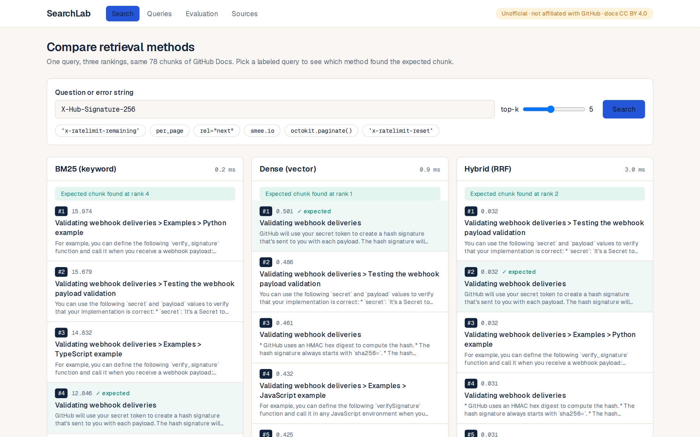

# SearchLab

Run one query through **BM25**, **dense (vector)** and **hybrid (RRF)** retrieval and compare the three rankings side by side. A labeled query set scores each method with **Recall@5** and **MRR@10**. Every number below comes from a saved run in [`runs/`](runs/).



> **Unofficial.** Independent portfolio project, not affiliated with or endorsed by GitHub. The indexed text is six pages of [github/docs](https://github.com/github/docs) (CC BY 4.0), pinned to commit `9568e964`. See [NOTICE.md](NOTICE.md).

## Results (frozen test split, N=30, run once)

| method | Recall@5 | MRR@10 |
|---|---|---|
| BM25 | 1.000 | 0.747 |
| Dense (`text-embedding-3-small`) | 1.000 | 0.794 |
| Hybrid (RRF, k=60) | 1.000 | 0.856 |

Run: [`runs/20261027T115232Z-test-k60`](runs/20261027T115232Z-test-k60) · analysis: [`analysis.md`](runs/20261027T115232Z-test-k60/analysis.md)

**What this does and does not show**
- Recall@5 is saturated. The corpus has only 78 chunks, so the top 5 is about 6% of it. Use MRR@10 to compare methods here.
- N=30 is small. No confidence intervals were computed. Treat gaps of a few hundredths as noise.
- I expected dense search to miss exact API identifiers. **It did not.** Dense ranked `X-Hub-Signature-256` first where BM25 ranked it 4th, while BM25 won on `secure_compare` and `x-ratelimit-used`. Hybrid never ranked the first expected chunk below 3rd and was never strictly worse than both other methods (it tied the lowest rank on 3 queries).
- Queries are synthetic: written by the author with model help, then keyword-checked against their gold chunks. Some queries have more than one acceptable chunk.

## Run it

Needs Docker. No API key is required: vectors for all 78 chunks and all 45 queries are committed in `fixtures/github-docs/embeddings_cache/`.

```bash
docker compose up --build
# web: http://localhost:3000   api: http://localhost:8000/docs
```

A query that is not in the cache returns `503 embedding_unavailable` unless you set `OPENAI_API_KEY` in your environment. Ports bind to `127.0.0.1` only. With a key set, every new query calls the OpenAI embeddings API and is appended to the cache file, so do not expose this publicly.

### Without Docker

```bash
cd services/api && uv sync
uv run searchlab search "x-ratelimit-remaining"   # CLI, three methods
uv run uvicorn searchlab.api.main:app --port 8000
cd ../../apps/web && pnpm install && pnpm dev
```

### Reproduce the evaluation

```bash
cd services/api
uv run searchlab verify              # snapshot files match manifest checksums
uv run searchlab tune                # RRF k on the DEV split only
uv run searchlab eval --split test   # writes runs/<run_id>/
```

Each run folder has `run_manifest.json` (git SHA, dataset/corpus/chunk checksums, embedding model, k, N), `per_case_results.jsonl`, `scores.csv`, `chart.png`, `checksums.txt`.

## How it works

```
Next.js UI ─HTTP→ FastAPI ─→ SearchService ─┬ Bm25Retriever
                                            ├ DenseRetriever ─→ Embedder (cached) + Qdrant
                                            └ HybridRetriever (RRF over the two)
```

- `corpus/`: fetch pinned pages, strip Liquid, chunk by heading, stable content-hash chunk IDs, checksummed manifest
- `retrieval/`: identifier-aware tokenizer, BM25, dense, RRF
- `embeddings/`: OpenAI adapter, disk cache decorator, fake embedder for tests
- `eval/`: pure metrics, runner, run artifacts
- `services/`, `api/`: use cases and HTTP layer; `wiring.py` is the only place that picks concrete classes

Design decisions: [`docs/adr/`](docs/adr/). Code walkthrough: [`docs/CODE_TOUR.md`](docs/CODE_TOUR.md).

## Tests

```bash
cd services/api && uv run pytest && uv run ruff check . && uv run mypy
cd apps/web && pnpm lint && pnpm typecheck && pnpm test
# browser smoke tests (API on :8000 and web on :3000 must be running)
pnpm exec playwright test
```

## Known limits
- 78 chunks from 6 pages. Results will not transfer to large corpora.
- No reranker, no query rewriting, one embedding model.
- Cleaning drops GitHub's shared `reusables` snippets (text lives in other files), so a few sections are shorter than on docs.github.com.
- UI was built by hand to a small design token set. A Google Stitch pass was attempted and could not authenticate.
