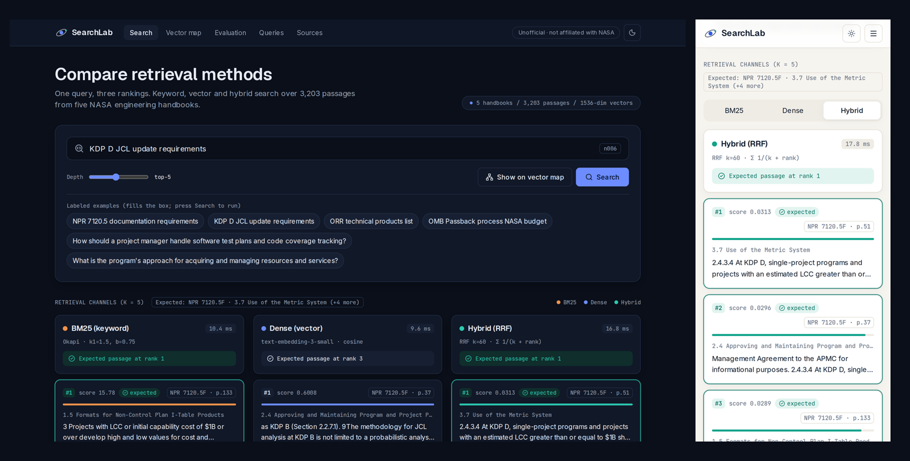
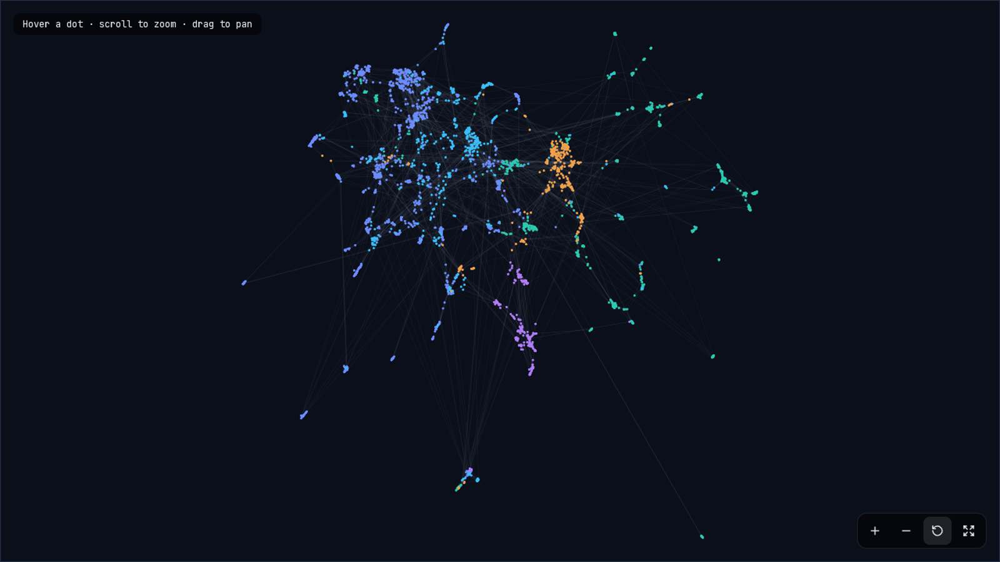
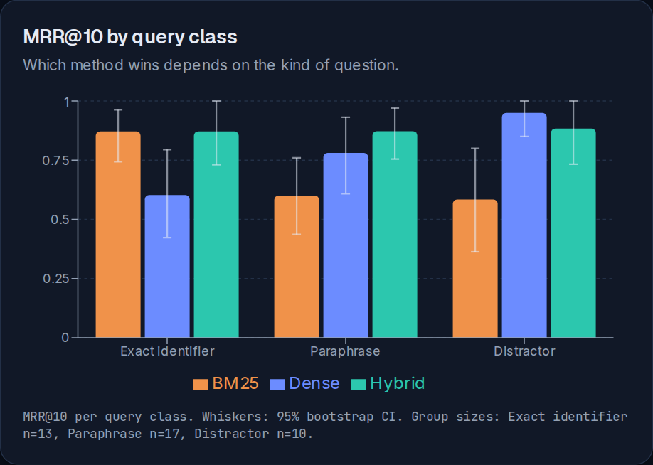

# SearchLab

**Compare keyword, vector and hybrid search on 3,203 passages from five NASA engineering handbooks, and measure which one finds the right answer.**

SearchLab runs one question through three retrievers and shows the rankings side by side. A labeled set of 120 questions scores each method, with 95% confidence intervals, and a WebGL map shows every passage in embedding space.



> **Unofficial.** Independent portfolio project, not affiliated with or endorsed by NASA. The handbooks are US Government works (17 U.S.C. §105). See [NOTICE.md](NOTICE.md).

## What's inside

| Page | What it does |
|---|---|
| **Search** | One question, three ranked columns: **BM25** (keyword), **Dense** (vector, `text-embedding-3-small`) and **Hybrid** (Reciprocal Rank Fusion). For a labeled question it shows where each method placed the expected passage. |
| **Vector map** | All 3,203 passages as dots, placed by meaning (UMAP) and linked to their 5 nearest neighbours. A search lights up what each method retrieved. |
| **Evaluation** | Score cards (MRR@10 with 95% CI, Recall@1/5, nDCG@10), a Recall@k curve, results by question type, head-to-head counts and a per-question rank heatmap. Every number comes from a saved run folder. |
| **Queries** | The 120 labeled questions (40 tuning, 80 holdout), filterable and paginated. |
| **Sources** | The five NASA PDFs with page counts, checksums and how the corpus is built. |

Light and dark themes, mobile layouts and keyboard navigation throughout.





## Results so far

> **Preliminary.** These numbers come from the 40-question **tuning set**, used to choose settings, so they are optimistic. The labels are still being spot-checked by a person. The 80-question **holdout** run comes after that and will replace this section.

| Method | MRR@10 (95% CI) | Recall@1 | Recall@5 | nDCG@10 |
|---|---|---|---|---|
| BM25 | 0.685 (0.581 to 0.791) | 52.5% | 90.0% | 0.577 |
| Dense | 0.765 (0.661 to 0.868) | 65.0% | 90.0% | 0.620 |
| Hybrid | 0.875 (0.796 to 0.946) | 77.5% | 100.0% | 0.693 |

MRR@10 by question type:

| Type | n | BM25 | Dense | Hybrid |
|---|---|---|---|---|
| Exact identifier (e.g. "KDP C") | 13 | 0.872 | 0.603 | 0.872 |
| Paraphrase | 17 | 0.600 | 0.780 | 0.873 |
| Distractor | 10 | 0.584 | 0.950 | 0.883 |

Keyword search wins on exact identifiers, vector search wins on reworded questions, and hybrid is strong on both. With 10 to 17 questions per type the intervals are wide, so small gaps are noise.

## Quick start (Docker)

You need Docker with Compose v2.24 or newer. No API key is required: vectors for all 3,203 passages and all labeled questions are committed.

```bash
git clone https://github.com/shisukeUrahara/searchlab.git
cd searchlab

# Optional: add your OpenAI key so brand-new questions work in vector and hybrid search
cp services/api/.env.example services/api/.env   # then edit OPENAI_API_KEY

docker compose up --build
```

| Service | URL |
|---|---|
| Web app | http://localhost:3000 |
| API docs (OpenAPI) | http://localhost:8000/docs |

The API takes about 20 seconds on first start while it loads the vectors into Qdrant. Stop everything with `docker compose down`.

Ports bind to `127.0.0.1` only. Don't expose the API publicly with a key set: every new question calls the OpenAI embeddings API.

## Local development (without Docker)

You need Python 3.12 with [uv](https://docs.astral.sh/uv/), and Node 24 with pnpm 10.

**Terminal 1: API**

```bash
cd services/api
cp .env.example .env        # optional, then edit OPENAI_API_KEY
uv sync
uv run uvicorn searchlab.api.main:app --port 8000
```

**Terminal 2: web app**

```bash
cd apps/web
cp .env.example .env.local  # optional, defaults already point at localhost:8000
pnpm install
pnpm dev
```

Open http://localhost:3000. Without `QDRANT_URL`, the API keeps vectors in memory, so no Qdrant server is needed.

## Environment variables

| Variable | File | Default | What it does |
|---|---|---|---|
| `OPENAI_API_KEY` | `services/api/.env` | unset | Embeds new questions with `text-embedding-3-small`. Also needed to rebuild the corpus or labels. |
| `SEARCHLAB_CORPUS` | `services/api/.env` | `nasa` | Corpus to serve: `nasa`, or `github-docs` for the archived v1. |
| `QDRANT_URL` | `services/api/.env` | unset (in-memory) | Qdrant server to use. Docker Compose sets `http://qdrant:6333`. |
| `CORS_ORIGINS` | `services/api/.env` | `http://localhost:3000` | Comma-separated browser origins allowed to call the API. |
| `NEXT_PUBLIC_API_URL` | `apps/web/.env.local` | `http://localhost:8000` | Where the browser reaches the API. Read at build time. |
| `E2E_BASE_URL` | shell | `http://localhost:3000` | Web app URL for the Playwright tests. |

Both `.env` files are gitignored. Docker Compose reads `services/api/.env` when the container starts; it is never copied into the image.

### What works without a key

| Question | BM25 | Dense | Hybrid |
|---|---|---|---|
| A labeled example (vectors are committed) | yes | yes | yes |
| A brand-new question | yes | needs key | needs key |

Without a key, a new question still returns BM25 results. The Dense and Hybrid columns explain that an embedding is needed.

## Troubleshooting

| Problem | Fix |
|---|---|
| "Cannot reach the API" in the web app | Check the API is running: `curl localhost:8000/health`. In Docker, wait for the first start to finish. |
| Port 3000 or 8000 already in use | Find the process with `lsof -i :3000` and stop it, or stop old containers with `docker compose down`. |
| "The embedding provider rejected this request" in the Dense/Hybrid columns | `OPENAI_API_KEY` is wrong or still the fake placeholder from `.env.example`. Fix it and restart the API. BM25 keeps working meanwhile. |
| Web app on another port is blocked by CORS | Add its origin to `CORS_ORIGINS`, for example `http://localhost:3001`. |
| Changed `NEXT_PUBLIC_API_URL` but nothing changed | It is read at build time. Restart `pnpm dev`, or rebuild with `docker compose up --build`. |
| Vector map is blank | Your browser has WebGL turned off. Try Chrome or Firefox with hardware acceleration on. |
| Evaluation page says "No evaluation runs yet" | Create one: `cd services/api && uv run searchlab eval --split dev`. |

## How it works

```
Next.js UI ──HTTP──> FastAPI ──> SearchService ─┬─ Bm25Retriever
                                                ├─ DenseRetriever ──> CachingEmbedder (OpenAI) + Qdrant
                                                └─ HybridRetriever (RRF over the two)
                         └─────> EvalService ──> metrics + bootstrap CIs ──> runs/<corpus>/<run_id>/
```

1. **Corpus.** Five public NASA PDFs are downloaded and checksummed. Running headers and footers are stripped, sections come from the PDF outline (or numbered headings), and text is packed into passages of up to 1,000 characters. Passage IDs are a hash of document, section and text, so rebuilds are byte-identical.
2. **Retrieval.** BM25 uses a tokenizer that keeps identifiers like `NPR 7123.1` whole. Dense search uses `text-embedding-3-small` (1,536 dimensions) with cosine similarity in Qdrant. Hybrid fuses both with Reciprocal Rank Fusion (k = 60).
3. **Labels.** An LLM drafts 120 questions from passages in three types. A stronger LLM judges which pooled top-10 results also answer each one (graded 0 to 2; only 2 counts). A person spot-checks a random sample.
4. **Evaluation.** Recall@1/3/5/10, MRR@10 and nDCG@10 per method and question type, with 95% bootstrap confidence intervals.
5. **Vector map.** UMAP projects the vectors to 2D, and each passage links to its 5 nearest neighbours. It is precomputed into `graph.json` and drawn with sigma.js (WebGL).

### Project structure

```
searchlab/
├── services/api/                 FastAPI service and CLI (Python 3.12, uv)
│   └── src/searchlab/
│       ├── corpus/               fetch, PDF loader, chunker, manifest, corpus registry
│       ├── retrieval/            tokenizer, BM25, dense, hybrid (RRF)
│       ├── embeddings/           OpenAI adapter, disk cache, fake embedder for tests
│       ├── store/                Qdrant vector store (batched upserts)
│       ├── eval/                 metrics, bootstrap CIs, runner, run artifacts
│       ├── labeling/             LLM drafting, pooled judging, human review sheet
│       ├── viz/                  UMAP layout and kNN graph
│       ├── services/, api/       use cases and HTTP layer
│       └── wiring.py             the only place that picks concrete classes
├── apps/web/                     Next.js app (search, map, evaluation, queries, sources)
├── fixtures/nasa/                manifest, chunks, labeled queries, cached vectors, graph
├── fixtures/github-docs/         archived v1 corpus
├── runs/                         saved evaluation runs
├── design/stitch/                Google Stitch design exports
└── docs/                         decision records, code tour, label review sheet
```

Design decisions: [`docs/adr/`](docs/adr/). Code walkthrough: [`docs/CODE_TOUR.md`](docs/CODE_TOUR.md).

## Tests

```bash
# API: 100 unit and integration tests, lint, strict types
cd services/api
uv run pytest -q
uv run ruff check .
uv run mypy

# Web: component tests, lint, types, production build
cd apps/web
pnpm test
pnpm lint
pnpm typecheck
pnpm build
```

**Browser tests** need the API and web app running (Docker or local). They cover desktop and a Pixel 7 phone, light and dark themes, no sideways scrolling, and automatic WCAG A/AA accessibility checks on every page.

```bash
cd apps/web
pnpm exec playwright install chromium   # first time only
pnpm exec playwright test               # set E2E_BASE_URL if the app is not on :3000
```

GitHub Actions runs the API and web checks on every push.

## Reproduce the evaluation

All commands run from `services/api`. Use `--corpus github-docs` for the archived v1.

```bash
uv run searchlab --corpus nasa fetch    # download the 5 PDFs (not committed); rewrites source_manifest.json
uv run searchlab --corpus nasa verify   # PDFs match the manifest checksums
uv run searchlab --corpus nasa chunk    # rebuild chunks.jsonl (identical output on rerun)
uv run searchlab tune                   # compare RRF k values on the tuning set only
uv run searchlab eval --split dev       # tuning-set run
uv run searchlab eval --split test      # holdout run: refuses to start if git has uncommitted changes
```

Each run writes `runs/<corpus>/<run_id>/` with `run_manifest.json` (git commit, clean-tree flag, dataset and corpus checksums, model, k, N), `per_case_results.jsonl`, `scores.json`, `scores.csv`, `chart.png` and `checksums.txt`.

Confidence intervals are 95% percentile bootstrap over questions (1,000 draws, fixed seed).

### CLI reference

| Command | What it does | Needs a key |
|---|---|---|
| `fetch` | Download source documents and write the manifest | no |
| `verify` | Check downloaded files against manifest checksums | no |
| `chunk` | Clean and split documents into `chunks.jsonl` | no |
| `embed` | Embed every chunk (cache first) | only for uncached chunks |
| `search "<question>"` | Run one question through all three methods | only for new questions |
| `tune` | Compare RRF k values on the tuning set | no |
| `eval --split dev\|test` | Score all methods and write a run folder | no |
| `draft-queries` | Draft labeled questions with an LLM | yes |
| `judge-pool` | LLM-judge pooled top-10 results to build answer sets | yes |
| `review-sheet` | Write `docs/label_review.md` for a human spot-check | no |
| `apply-review` | Apply the spot-check and report agreement | no |
| `project` | Rebuild the vector map (`uv sync --group viz` first) | no |

## Known limits

- **Synthetic, LLM-judged labels.** Questions are drafted from passages, which can favour keyword matching. The first LLM judge was too lenient; the stricter one is better but not perfect, which is why a person spot-checks a sample.
- **Small groups.** 10 to 17 questions per type. Read the confidence intervals, not just the averages.
- **PDF extraction noise.** Tables and diagrams extract poorly, and a few chunks still carry footer text such as "This document does not bind the public".
- **One embedding model, no reranker, no query rewriting.**
- **The map is a 2D approximation.** Nearby dots are similar, but distances are not exact.

## v1 (archived): GitHub Docs

The first version used six GitHub Docs pages (78 chunks). It is kept for reproducibility under `fixtures/github-docs` and `runs/github-docs`.

Frozen test split, N=30, run once:

| method | Recall@5 | MRR@10 |
|---|---|---|
| BM25 | 1.000 | 0.747 |
| Dense (`text-embedding-3-small`) | 1.000 | 0.794 |
| Hybrid (RRF, k=60) | 1.000 | 0.856 |

Run: [`runs/github-docs/20261027T115232Z-test-k60`](runs/github-docs/20261027T115232Z-test-k60) · analysis: [`analysis.md`](runs/github-docs/20261027T115232Z-test-k60/analysis.md)

**What this does and does not show**
- Recall@5 is saturated. The corpus has only 78 chunks, so the top 5 is about 6% of it. Use MRR@10 to compare methods here.
- N=30 is small. No confidence intervals were computed. Treat gaps of a few hundredths as noise.
- I expected dense search to miss exact API identifiers. **It did not.** Dense ranked `X-Hub-Signature-256` first where BM25 ranked it 4th, while BM25 won on `secure_compare` and `x-ratelimit-used`. Hybrid never ranked the first expected chunk below 3rd and was never strictly worse than both other methods (it tied the lowest rank on 3 queries). On the larger NASA corpus the expected pattern does appear: keyword search beats vector search on identifiers (see Results so far).
- Queries are synthetic: written by the author with model help, then keyword-checked against their gold chunks. Some queries have more than one acceptable chunk.

## License and sources

Code: MIT ([LICENSE](LICENSE)). NASA documents are US Government works and are not stored in this repository; they are downloaded by `searchlab fetch`. The archived v1 corpus uses GitHub Docs content under CC BY 4.0. Details in [NOTICE.md](NOTICE.md).
